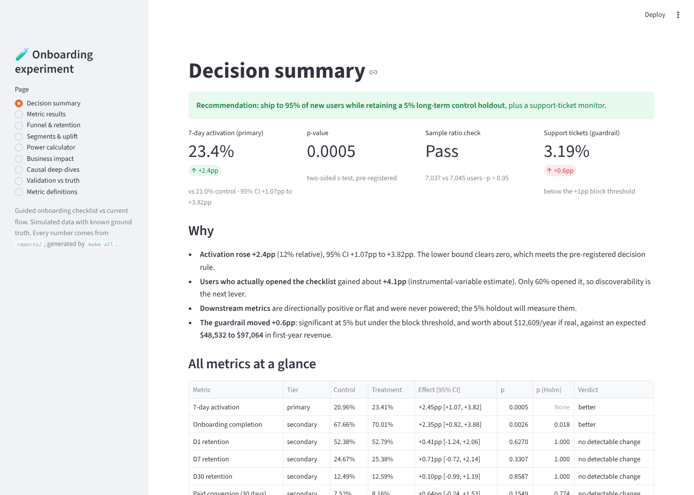
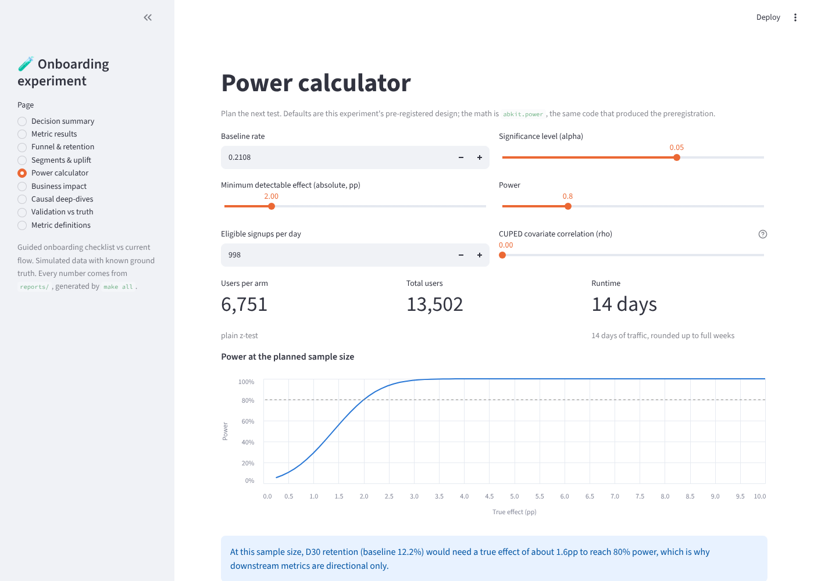
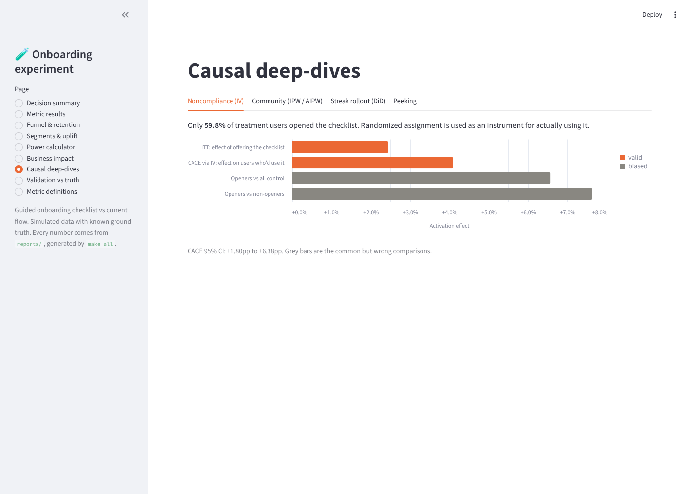

# Onboarding Experiment: A/B Testing & Causal Inference, End to End

[](https://github.com/Sanjay180803/Onboarding-Experiment-/actions/workflows/reproduce.yml)

A complete product-experimentation case study: a subscription app tests a **guided onboarding checklist**. The project covers the full lifecycle a product data scientist owns — funnel diagnosis → pre-registered design and power analysis → analysis with proper inference → causal inference where randomization breaks down → a business recommendation with dollar impact.

The data is **synthetic with known ground truth**, so every estimator is checked against the true causal effect. Naive methods are shown to fail and principled ones to succeed.

## Headline results

| Question | Method | Result | Truth |
|---|---|---|---|
| Does the checklist lift 7-day activation? | Two-proportion z-test, 14k users | **+2.45pp** [+1.07, +3.82], p = 0.0005 (+11.7% relative) | +2.90pp ✓ |
| Effect on users who actually *used* it? | IV / CACE (randomization as instrument) | **+4.1pp** [+1.8, +6.4]; naive comparisons say +6.6 to +7.6pp | +4.9pp ✓ |
| Does joining the community *cause* retention? | IPW and doubly robust AIPW | **+3.5pp** D30 retention; naive says +6.9pp | +3.4pp ✓ |
| Did streak reminders work? (non-random rollout, 12 markets) | Difference-in-differences + event study, with wild cluster bootstrap and randomization inference for few clusters | **+2.1pp** weekly active rate; naive says +5.0pp | +2.0pp ✓ |
| Is daily peeking safe? | 5,000 simulated A/A tests | Naive peeking: **21.7% false positives**; mSPRT: 1.1% | — |
| Decision | Decision memo | **Ship to 95% of new users, keep a 5% long-term control holdout**; worth roughly $49k–$97k/yr | — |

## Skills demonstrated

| Skill | Where |
|---|---|
| Product funnels & retention | `sql/` (DuckDB): strict ordered funnel, N-day retention curves, weekly cohort table |
| A/B test design | `docs/preregistration.md`: seeded 50/50 Bernoulli assignment at the user level; hypothesis, primary/secondary/guardrail metrics, decision rule written before analysis |
| Power analysis | `abkit/power.py`: sample size, MDE, analytic power validated by simulation, runtime rounded to full weeks |
| Significance & confidence intervals | `abkit/inference.py`: SRM check, z-test, Welch, bootstrap (heavy-tailed revenue), delta method (ratio metrics), Holm correction |
| Variance reduction | `abkit/variance_reduction.py`: CUPED, and CUPAC with an ML covariate trained on the pre-period cohort |
| Sequential testing | `abkit/sequential.py`: peeking simulation, always-valid mSPRT p-values |
| Causal inference | `abkit/causal.py`: IV/CACE; IPW (full-sample propensity) and AIPW with cross-fitted propensity and outcome models, balance diagnostics and an E-value; DiD and event study, plus exact wild cluster bootstrap and randomization inference for the 12-cluster case |
| Heterogeneous effects | `abkit/uplift.py`: cross-fitted T-learner, uplift by quintile, Qini |
| Business recommendation | `docs/decision_memo.md`: annualized impact range, guardrail cost-benefit, next tests |
| Dashboards & stakeholder communication | `dashboard/` (Streamlit): decision summary, metric results, funnel and retention, segments, causal deep-dives, plus live power and business-impact calculators |
| Metric definition with stakeholders | `metrics/catalog.yml`: one versioned definition per metric (numerator, denominator, window, good direction, owner, decision use), with the review process in `docs/metric_review.md`; CI checks it against the SQL and results |

## Dashboard

```bash
make all         # generate outputs (once)
make dashboard   # http://localhost:8501
```

| Decision summary | Power calculator | Causal deep-dives |
|---|---|---|
|  |  |  |

Nine pages, all driven by `reports/` and `metrics/catalog.yml`:
- **Decision summary**: recommendation, primary KPI, SRM and guardrail checks, all metrics with verdicts that respect each metric's good direction (tickets going up count as *worse*).
- **Metric results**: interactive forest plot with tier filter and per-metric definitions.
- **Funnel & retention**, **Segments & uplift** (with a multiple-comparisons warning), **Causal deep-dives** (IV, IPW/AIPW with balance, DiD with few-cluster checks, peeking), **Validation vs truth**.
- **Power calculator**: plan the next test (baseline, MDE, alpha, power, traffic, CUPED correlation). Uses `abkit.power`, and a test pins its defaults to the preregistered 6,751 users per arm.
- **Business impact**: change LTV, the causal share of the activation-to-payer link, rollout share and ticket cost; the activation CI carries through to revenue. A test pins its defaults to the memo's numbers.
- **Metric definitions**: the catalog, rendered, with its changelog.

The dashboard is tested headlessly in CI with Streamlit's `AppTest`: every page must render without exceptions, and both calculators must reproduce the report at default inputs. To host it publicly, deploy `dashboard/app.py` from this repo on [Streamlit Community Cloud](https://streamlit.io/cloud) (free, sign in with GitHub).

## Repo layout

```
sim/simulate.py          Event-log simulator with known causal effects (writes data/, ground truth to data/_truth/)
sql/                     DuckDB SQL: user-level metrics, funnel, retention curve, cohort table
abkit/                   Reusable, tested experimentation toolkit
analysis/01_design.py    Design from PRE-experiment data only -> docs/preregistration.md
analysis/02_analyze.py   Full analysis -> reports/results.json + figures
analysis/03_validate.py  Compare every estimate with ground truth
analysis/04_report.py    Generate reports/report.md and docs/decision_memo.md
dashboard/               Streamlit dashboard (app.py) and its tested data layer (data.py)
metrics/catalog.yml      Metric definitions: the single source of truth
tests/                   15 statistical correctness tests (CI coverage, false-positive control, recovery of known effects),
                         plus metric-catalog consistency and headless dashboard tests
.github/workflows/       GitHub Actions: locked install, tests, full pipeline from scratch, output checks
```

## Run it

```bash
python -m venv .venv && source .venv/bin/activate     # Python 3.13
pip install -r requirements.lock                      # exact versions the results were produced with
make all        # tests -> simulate -> design -> analyze -> validate -> report  (~3 min)
```

Every number in the report and memo is generated from code. Change the seed (`python sim/simulate.py --seed 11`) and the whole story regenerates.

**Reproducibility.** `requirements.txt` pins the direct dependencies and `requirements.lock` pins every transitive package, because statistical output can shift across SciPy, statsmodels and scikit-learn versions. BLAS/OpenMP run single-threaded (set in the `Makefile` and the workflow), so results don't depend on core count. On every push, a GitHub Actions workflow installs the lock file, runs the tests (statistics, metric catalog, dashboard), deletes all generated outputs, reruns the full pipeline, checks that every report, figure and JSON file was regenerated and that every principled CI still covers the ground truth, and diffs the regenerated report against the committed one.

## Things worth discussing in an interview

- **Few clusters.** The DiD has only 12 markets, where cluster-robust SEs are known to mislead. The report adds an exact wild cluster bootstrap (all 4,096 sign patterns) and randomization inference (all 924 assignments), plus a null simulation: CR1 rejects a true null 10.7% of the time with 6 treated markets and 30% with 2, versus 7.3% and 10.7% for the wild bootstrap.

- **The guardrail false positive.** Support tickets rose significantly (p = 0.03), yet the true effect is zero. Across about 10 tests at alpha = 0.05, one miss is expected. The pre-registered rule (a block threshold plus a cost-benefit check) avoided killing a good launch over noise.
- **CUPED barely helped (4%).** New users have little pre-period behavior. Knowing *when* a technique won't help is as useful as knowing how to apply it.
- **Revenue moved the "wrong" way** while paid conversion rose. Revenue is heavy-tailed (annual vs monthly plans), and the test wasn't powered for it, as stated in the design. Hence the recommended 90-day holdout.
- **Translating activation into dollars needs a causal link**, not the raw "activated users pay more" gap, which is confounded by motivation. The memo shows a range rather than a falsely precise number.
- **Uplift modeling is weak at this sample size.** Rank correlation with the true individual effect is about 0.11. Segment-level effects are informative, but a per-user targeting model is not yet justified.

## Extending it
- Apply the same `abkit` analysis to a public dataset (e.g. the Kaggle *Cookie Cats* mobile-game retention A/B test).
- Add Bayesian analysis (beta-binomial posterior, expected loss) alongside the frequentist results.
- Replace the DiD with Callaway–Sant'Anna for a staggered rollout.
