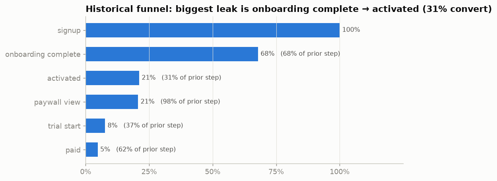
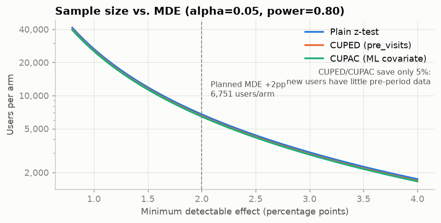
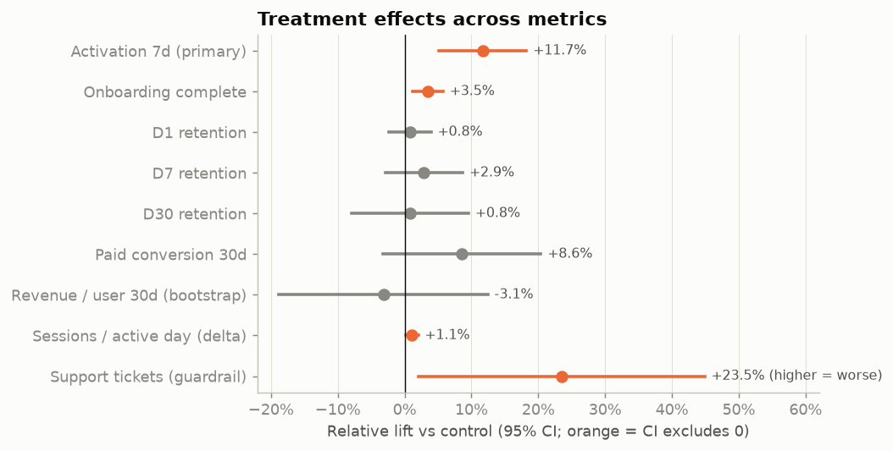
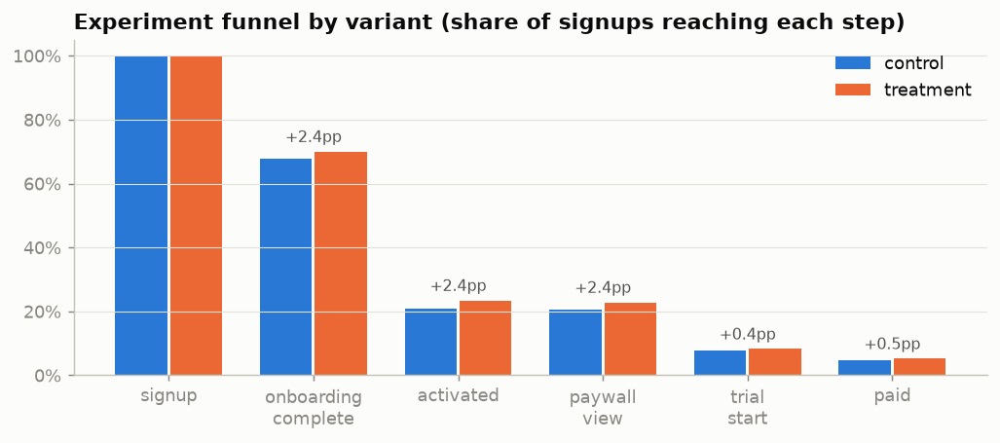
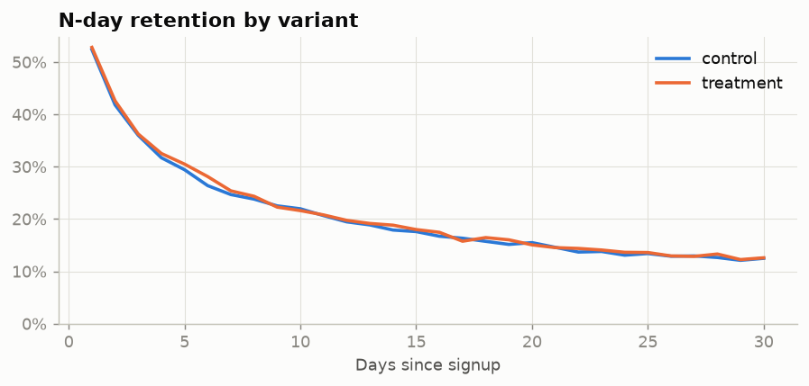
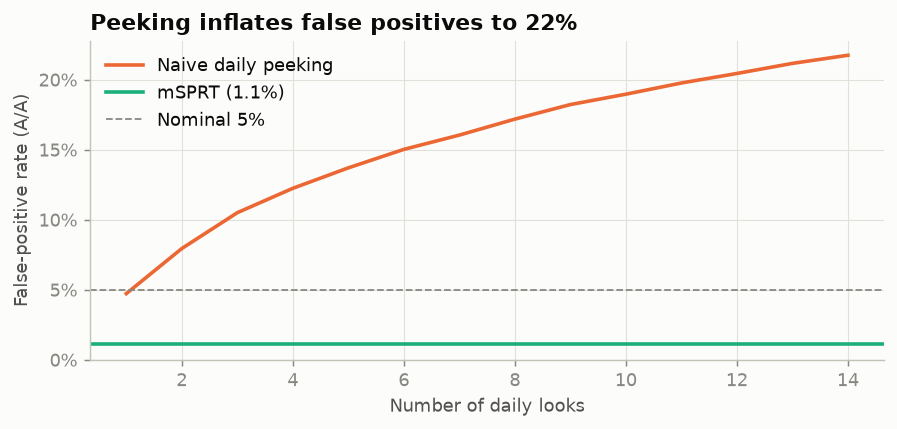
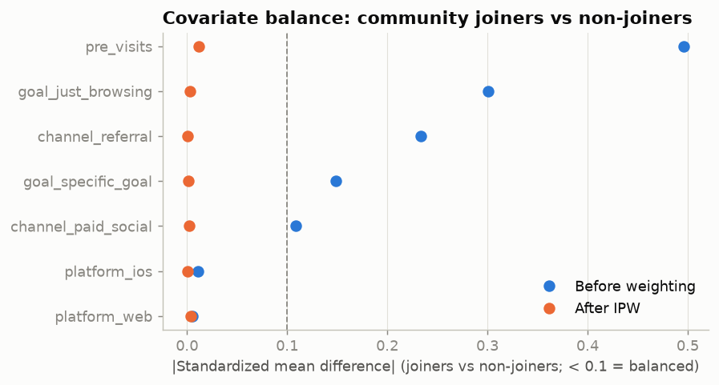
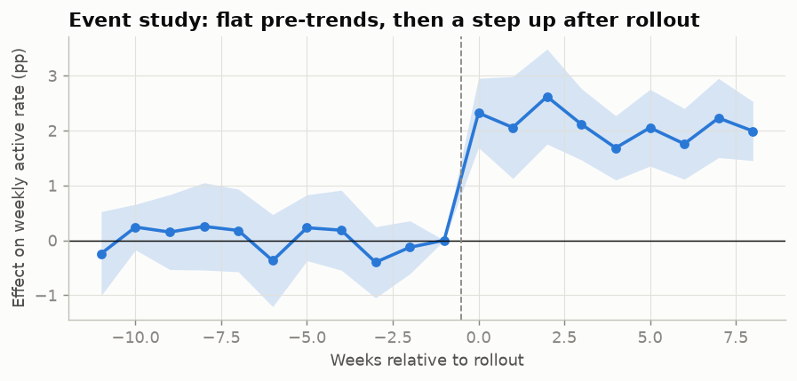
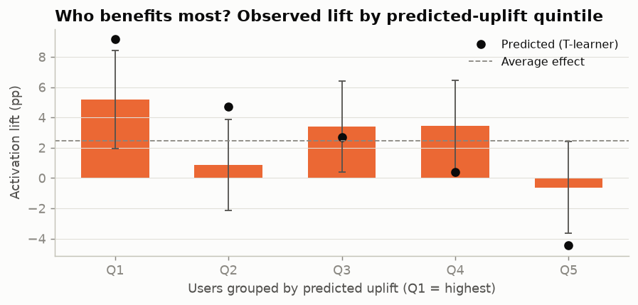

# Technical report: Guided Onboarding Checklist experiment

All numbers are generated by `analysis/02_analyze.py` and `analysis/03_validate.py`. Figures are in `reports/figures/`.

## 1. Design recap (from the pre-experiment cohort)
Baseline 7-day activation was 21.08%. To detect +2pp at alpha = 0.05 and 80% power we needed **6,751 users per arm** (simulated power 80.6%), i.e. **14 days** at ~998 signups/day. See `docs/preregistration.md`.

## 2. Trust checks
- **Sample ratio:** 7,037 control vs 7,045 treatment, chi-square p = 0.946. No SRM.
- **Guardrail, support tickets (7d):** 2.59% → 3.19%, +0.61pp [+0.05, +1.16], p = 0.031. Significant at 5%, but below the pre-registered +1pp block threshold. See section 9: in this simulation the true effect is zero, so this is a false positive, which is expected roughly once across 9 tests at alpha = 0.05.

## 3. Primary metric: 7-day activation
| | Control | Treatment | Absolute lift [95% CI] | Relative lift [95% CI] | p |
|---|---|---|---|---|---|
| Activation 7d | 20.96% | 23.41% | **+2.45pp** [+1.07, +3.82] | 11.7% [4.7%, 18.6%] | 0.00048 |

**Variance reduction.** CUPED on pre-signup visits (rho = 0.17) cut variance by 2.9%. CUPAC, with a gradient-boosted prediction trained on the historical cohort only, cut it by 4.1%: +2.46pp [+1.11, +3.80]. The gains are small because new users have little pre-period behavior, which is typical of onboarding tests. For tests on existing users, where prior-period activity is available, the reduction is usually much larger.

## 4. Secondary metrics (Holm-corrected)
| Metric | Control | Treatment | Diff [95% CI] | p | p (Holm) |
|---|---|---|---|---|---|
| Onboarding complete (7d) | 67.7% | 70.0% | +2.35pp [+0.82pp, +3.88pp] | 0.003 | 0.018 |
| D1 retention | 52.4% | 52.8% | +0.41pp [-1.24pp, +2.06pp] | 0.627 | 1.000 |
| D7 retention | 24.7% | 25.4% | +0.71pp [-0.72pp, +2.14pp] | 0.331 | 1.000 |
| D30 retention | 12.5% | 12.6% | +0.10pp [-0.99pp, +1.19pp] | 0.859 | 1.000 |
| Paid conversion (30d) | 7.5% | 8.2% | +0.64pp [-0.24pp, +1.53pp] | 0.155 | 0.774 |
| Revenue / user (30d), bootstrap | $2.54 | $2.46 | -0.080 [-0.478, +0.315] | 0.694 | 1.000 |
| Sessions / active day, delta method | 1.923 | 1.944 | +0.021 [+0.003, +0.039] | 0.025 | 0.152 |

Onboarding completion moves as expected, since it is the mechanism. Retention, paid conversion and revenue are directionally positive or flat with wide CIs. The design said this would happen: the MDE for D30 retention at this sample size is 1.6pp, and the observed effects are far smaller. Revenue per user is heavy-tailed (annual vs monthly plans), so its CI comes from a bootstrap. Sessions per active day is a ratio metric whose analysis unit (day) differs from the randomization unit (user), so its CI uses the delta method.

## 5. Sequential testing: why we didn't peek
In 5,000 simulated A/A tests at this traffic, stopping at the first daily p < 0.05 produced a **21.7% false-positive rate**, compared with 5.1% for a single look at the end. Always-valid mSPRT p-values held it at 1.1%. The price is power: with a +2.5pp true effect, the fixed-horizon test detects it 94% of the time and mSPRT 75% of the time. Applied to the real experiment, mSPRT would first have allowed a stop on **day 13** of 14.

## 6. Noncompliance: effect on users who actually used the checklist
Only 59.8% of treatment users opened the checklist. Randomized assignment serves as an instrument:

| Estimate | Value | Valid? |
|---|---|---|
| ITT (effect of *offering* the checklist) | +2.45pp | Yes, randomized |
| **CACE via IV** (effect of *using* it, for compliers) | **+4.09pp** [+1.80, +6.38] | Yes, under exclusion and monotonicity |
| Openers vs. all control | +6.57pp | No, openers are more motivated |
| Openers vs. non-openers | +7.63pp | No, badly confounded |

The naive comparisons overstate the effect by 61% and 87%. Practical implication: raising the open rate to 80% would lift ITT to about +3.27pp.

## 7. Observational question: does joining the community *cause* retention?
Community opt-in is self-selected, so joiners and non-joiners differ before they join (max standardized mean difference 0.50).

| Method | D30 retention effect [95% CI] |
|---|---|
| Naive (joiners − non-joiners) | +6.87pp |
| Inverse propensity weighting (propensity fitted on the full sample) | +3.70pp [+2.52, +4.61] |
| AIPW (doubly robust; propensity and outcome models both cross-fitted) | **+3.51pp** [+2.28, +4.42] |

Bootstrap CIs (200 resamples) refit every model inside each resample. The IPW propensity model is fitted on the full analyzed sample, which is the standard IPW estimator and is also what the balance check uses. For AIPW, all three nuisance models (one logistic propensity model and two gradient-boosted outcome models) are fitted out-of-fold with 2-fold cross-fitting, so no user's nuisance predictions come from a model trained on that user.

After weighting, the max SMD is 0.01 (good balance). About half of the naive gap was selection. **Sensitivity:** E-value = 1.99. An unmeasured confounder would need a risk ratio of about 2.0 with both joining and retention to explain the effect away. This is not proof, so the recommendation is to validate with a randomized encouragement test.

## 8. Non-randomized rollout: streak reminders (difference-in-differences)
Ops rolled streak reminders out to the 6 strongest of 12 markets in week 12, so assignment was not random.

| Method | Effect on weekly active rate |
|---|---|
| Naive: treated vs. untreated markets, post period | +4.95pp (selection on levels) |
| Naive: treated markets, before vs. after | +0.94pp (confounded by seasonality) |
| **DiD (market and week FE, CR1 clustered SE)** | **+2.08pp** [+1.95, +2.21] |

The event-study leads are flat, which supports parallel trends.

**Few-cluster limitation.** There are only 12 market clusters. Cluster-robust (CR1) standard errors are known to be unreliable with this few clusters, especially when few of them are treated or the treated ones are noisier. I report two sensitivity analyses, each computed exactly by full enumeration rather than by random draws:

| Inference method | p-value (H0: no effect) | 95% CI |
|---|---|---|
| CR1 cluster-robust SE, normal approximation | < 0.0001 | [+1.95, +2.21] |
| Wild cluster bootstrap-t, null imposed, all 4,096 Rademacher draws | 0.0005 (smallest attainable: 0.0005) | [+1.94, +2.22] (test inversion) |
| Randomization inference, all 924 ways to pick 6 treated markets | 0.0022 (smallest attainable: 0.0022) | [+1.98, +2.19] (constant-effect inversion) |

All three agree: the effect is clearly non-zero, and the CIs are nearly identical. Here that is because the effect is large relative to the market-level noise. With 12 clusters the p-values cannot get very small: both methods are already at their minimum attainable value.

**How much should we trust CR1 at 12 clusters in general?** A null Monte Carlo (300 panels per design, true effect = 0, AR(1) noise, treated markets noisier than controls):

| Treated markets (of 12) | CR1 false-positive rate | Wild cluster bootstrap | Randomization inference |
|---|---|---|---|
| 6 | 10.7% | 7.3% | 7.3% |
| 2 | 30.0% | 10.7% | 23.0% |

With a balanced 6-of-12 split, CR1 over-rejects moderately and the wild bootstrap is closer to the nominal 5%. With only 2 treated markets, CR1 rejects a true null far too often. Randomization inference also degrades in that case, because it assumes markets are exchangeable and the treated ones here have different noise. **Take-away:** for designs with few treated clusters, report the wild cluster bootstrap rather than CR1, and don't rely on randomization inference alone. Randomization inference here is a sensitivity check that treats the choice of markets as if random; identification still rests on parallel trends.

## 9. Heterogeneous effects
| Segment | n | Control activation | Lift [95% CI] |
|---|---|---|---|
| goal=build_habit | 4,964 | 24.6% | +2.54pp [+0.10, +4.97] |
| goal=just_browsing | 4,052 | 12.4% | +1.65pp [-0.43, +3.73] |
| goal=specific_goal | 5,066 | 24.2% | +3.05pp [+0.64, +5.45] |
| platform=android | 5,745 | 20.1% | +3.50pp [+1.36, +5.64] |
| platform=ios | 6,239 | 21.4% | +2.44pp [+0.37, +4.52] |
| platform=web | 2,098 | 21.9% | -0.44pp [-3.96, +3.09] |
| channel=organic | 6,320 | 20.8% | +1.99pp [-0.05, +4.02] |
| channel=paid_social | 5,724 | 19.1% | +2.47pp [+0.38, +4.55] |
| channel=referral | 2,038 | 26.7% | +3.88pp [-0.04, +7.80] |
| pre_visits<=1 (low intent) | 7,334 | 15.6% | +2.68pp [+0.97, +4.40] |
| pre_visits>=2 | 6,748 | 26.8% | +2.09pp [-0.05, +4.23] |

Cross-fitted T-learner, users grouped by predicted uplift:

| Quintile | Predicted | Observed lift [95% CI] |
|---|---|---|
| Q1 | +9.16pp | +5.17pp [+1.93, +8.41] |
| Q2 | +4.71pp | +0.87pp [-2.15, +3.89] |
| Q3 | +2.69pp | +3.41pp [+0.40, +6.42] |
| Q4 | +0.37pp | +3.43pp [+0.42, +6.45] |
| Q5 | -4.46pp | -0.62pp [-3.66, +2.41] |

There is directional evidence that low-intent users benefit more. However, the individual-level model's rank correlation with the true CATE is only 0.11: at about 14k users, segment-level heterogeneity is detectable but individual uplift barely is. The web-platform point estimate is negative with a wide CI. With 11 segment cuts and no pre-registered hypothesis, that is not evidence to exclude web.

## 10. Validation against ground truth (simulation only)
| Estimand | Method | Estimate | 95% CI | Truth | CI covers truth |
|---|---|---|---|---|---|
| ITT activation 7d | Two-proportion z-test | +0.0245 | [+0.0107, +0.0382] | +0.0290 | yes |
| ITT activation 7d | CUPAC-adjusted | +0.0246 | [+0.0111, +0.0380] | +0.0290 | yes |
| ITT onboarding completion | z-test | +0.0235 | [+0.0082, +0.0388] | +0.0247 | yes |
| ITT D7 retention | z-test | +0.0071 | [-0.0072, +0.0214] | +0.0084 | yes |
| ITT D30 retention | z-test | +0.0010 | [-0.0099, +0.0119] | +0.0036 | yes |
| ITT paid 30d | z-test | +0.0064 | [-0.0024, +0.0153] | +0.0039 | yes |
| ITT revenue / user 30d | Bootstrap | -0.0797 | [-0.4783, +0.3151] | +0.1221 | yes |
| ITT support tickets | z-test (guardrail) | +0.0061 | [+0.0005, +0.0116] | +0.0000 | **no** |
| CACE activation (compliers) | IV / Wald | +0.0409 | [+0.0180, +0.0638] | +0.0486 | yes |
| CACE activation (compliers) | Naive: openers vs control | +0.0657 | — | +0.0486 | — |
| CACE activation (compliers) | Naive: openers vs non-openers | +0.0763 | — | +0.0486 | — |
| Community effect on D30 | Naive joiners vs non | +0.0687 | — | +0.0341 | — |
| Community effect on D30 | IPW | +0.0370 | [+0.0252, +0.0461] | +0.0341 | yes |
| Community effect on D30 | AIPW (doubly robust) | +0.0351 | [+0.0228, +0.0442] | +0.0341 | yes |
| Streak reminders on WAU rate | Naive post-period comparison | +0.0495 | — | +0.0200 | — |
| Streak reminders on WAU rate | Naive before/after | +0.0094 | — | +0.0200 | — |
| Streak reminders on WAU rate | DiD, CR1 clustered SE | +0.0208 | [+0.0195, +0.0221] | +0.0200 | yes |
| Streak reminders on WAU rate | DiD, wild cluster bootstrap | +0.0208 | [+0.0194, +0.0222] | +0.0200 | yes |
| Streak reminders on WAU rate | DiD, randomization inference | +0.0208 | [+0.0198, +0.0219] | +0.0200 | yes |

Every principled estimator's CI covers the truth. Every naive comparison is off by 35%–148% of the true effect. The one CI that misses is the guardrail false positive, which is the expected ~5% miss rate showing up once.
